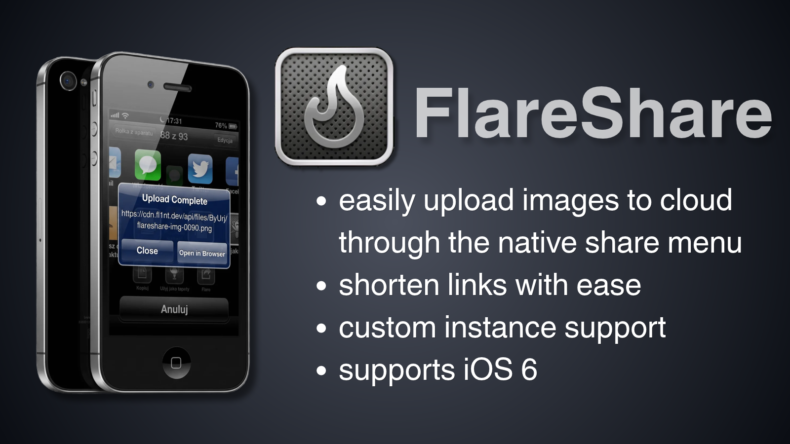
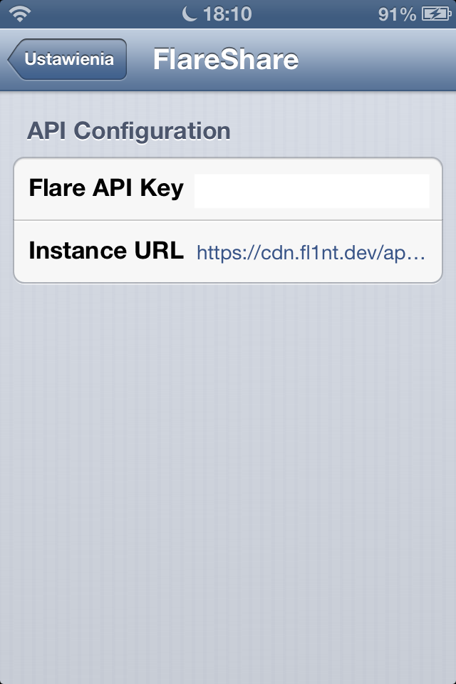

^ forgive me for my sloppy photoshop skills
# FlareShare

FlareShare is a iOS 6 jailbreak tweak that seamlessly integrates [Flare](https://github.com/flintsh/flare) into the native iOS Share Sheet that was introduced in iOS 6. It allows you to select photos directly from the Photos app and upload them to a custom CDN or API endpoint.

## Features

* **Native Share Sheet Integration:** Adds a custom "Flare" icon to the standard iOS Share Sheet.
* **Photos App Support:** Uploads images directly from the Photos app, including support for multiple selections.
* **Shorten links with ease** Supports automatic URL shortening via the share menu.
* **Custom API Support:** Configurable API endpoint and Authorization (Bearer) keys via the iOS Settings app.
* **One-Tap Access:** Alerts the user upon a successful upload with an option to instantly open the raw file URL in Safari.

## Compatibility

This tweak was developed with iOS 6 in mind, but it may work on later OS versions too.

## How It Works (Technical Details)

FlareShare utilizes Apple's private `NSTask` API to invoke the native `/usr/bin/curl` binary. This is due to the fact that native `NSURLSession` and `NSURLConnection` APIs didn't work reliably on my devices. I couldn't get them to work with SSL/TLS connections, even though I have all certificates updated.

To ensure stability:
* Make sure you have the latest certificates installed on your device.
* Install latest version of cURL from Cydia.
* Avoid the [SSLPatch tweak](https://github.com/rpetrich/SSLPatch), as it may interfere with our  ability to establish secure connections.

## Settings

Users can configure the tweak directly in the iOS **Settings app**. 
Preferences are stored in `/var/mobile/Library/Preferences/dev.pzurek.flareshare.plist`.

* **Instance URL:** The target URL for the POST request (Defaults to `https://cdn.fl1nt.dev/api/file`).
* **Flare API Key:** The token passed in the `Authorization: Bearer <key>` header. Get your API key from your dashboard.

## Building and Installation

This project is built using [Theos](https://theos.dev). 

1. Clone the repository:
   ```bash
   git clone https://github.com/smartfrigde/FlareShare.git
   cd FlareShare
   ```
2. Build the tweak:
   ```bash
    make package FINALPACKAGE=1
    ```
3. Install the generated `.deb` package on your jailbroken device using `dpkg` or any package manager of your choice.